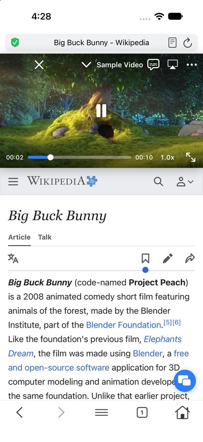
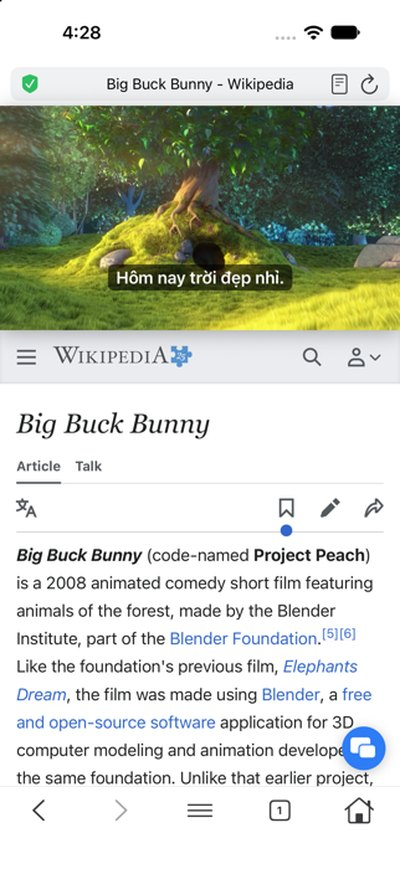
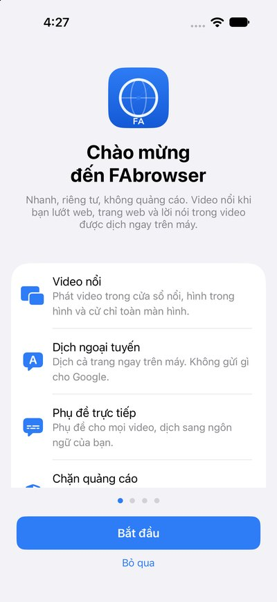
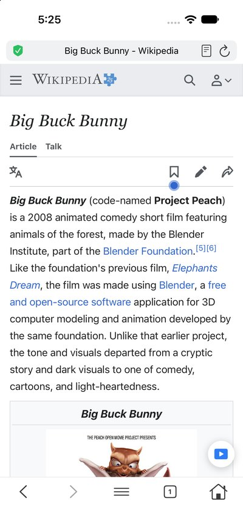
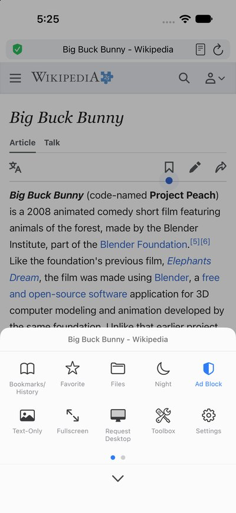
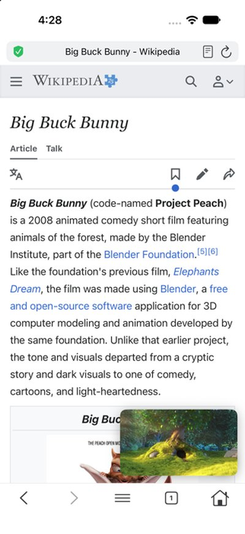
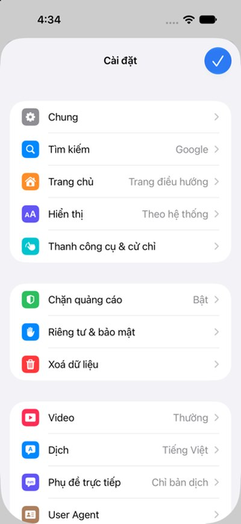
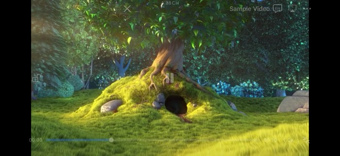
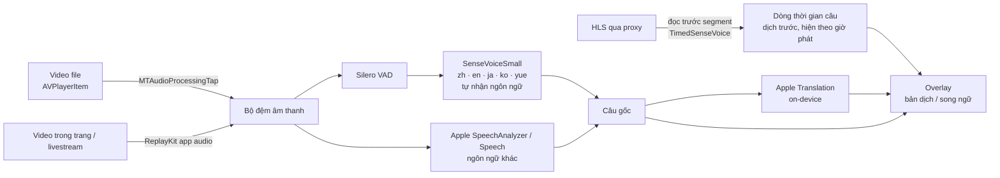
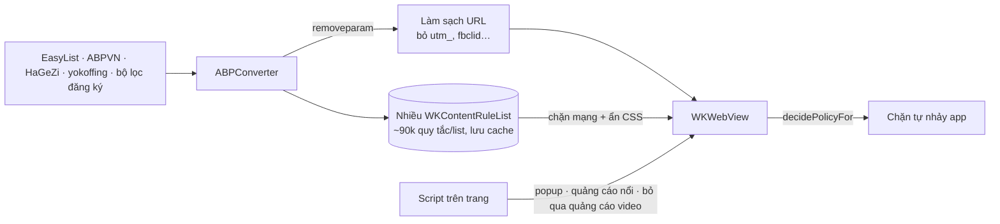

<div align="center">


# FAbrowser

**Trình duyệt iOS native, nhanh và riêng tư. Có video nổi, dịch trang ngoại tuyến, phụ đề trực tiếp cho mọi video và chặn quảng cáo mạnh tay.**

Viết bằng Swift + UIKit + WKWebView. Bố cục và luồng thao tác lấy cảm hứng từ Alook Browser.

[](#yêu-cầu)
[](https://swift.org)
[](#kiến-trúc)
[-34c759)](#dịch-trang-ngoại-tuyến)
[](https://github.com/yonaskolb/XcodeGen)
[](#bản-địa-hoá)

[Tính năng](#tính-năng-nổi-bật) · [Ảnh chụp](#ảnh-chụp-màn-hình) · [Bắt đầu](#bắt-đầu) · [Kiến trúc](#kiến-trúc) · [Lộ trình](#lộ-trình)

<br>

&nbsp;
&nbsp;
&nbsp;


</div>

---

## Tính năng nổi bật

<table>
<tr>
<td width="50%" valign="top">

### Video nổi
Bấm phát là video trên trang tách ra trình phát riêng. Bạn vẫn lướt web bình thường trong lúc xem.

- Ba chế độ: **ghim trên đầu** (đẩy trang xuống), **cửa sổ mini** kéo thả tự do, và **toàn màn hình ngang** có khoá thao tác, giờ và pin
- Tự mở cửa sổ khi bắt được video đang phát. Nhận ra quảng cáo pre-roll: để quảng cáo (và bộ đếm "bỏ qua sau 5s") chạy tiếp trong trang, rồi mới mở video chính
- **Bắt đúng video chính trên trang nhiều quảng cáo**: đọc danh sách quảng cáo VAST/VMAP trang tải về để biết file nào là quảng cáo, bỏ qua luồng m3u8 quảng cáo, iframe của mạng quảng cáo, video quảng cáo gắn link sang trang khác, video xem trước tự chạy không tiếng hoặc lặp lại ở góc màn hình. Tìm được cả video nằm trong shadow DOM, và mở video khi bạn bật tiếng cho video đang chạy không tiếng. Nếu cửa sổ lỡ mở quảng cáo thì tự chuyển sang video chính ngay khi nó bắt đầu phát
- Cử chỉ: kéo ngang để tua (xem trước thời gian), kéo dọc **bên trái** chỉnh âm lượng, **bên phải** chỉnh độ sáng (trái/phải tính theo khung hình, nên video 4:3 có viền đen vẫn đúng vùng), chạm hai lần ở mép trái/phải để tua 5 giây, nhấn giữ để phát nhanh, chụm hai ngón để đổi tỉ lệ khung
- **Tăng tốc tải video**: proxy cục bộ tải song song nhiều đoạn (MP4 theo khúc 1 MB, HLS theo segment), tải trước phía trước điểm đang xem và cache trong bộ nhớ nên tua mượt hơn
- Hình trong hình (PiP), phát trong nền, nhớ vị trí đang xem, tự thay video khi trang phát video mới
- Chế độ tương thích cho những trang tự chặn trình phát

</td>
<td width="50%" valign="top">

### Phụ đề trực tiếp
Chuyển lời nói trong **bất kỳ video nào** thành phụ đề, rồi dịch ngay trên máy sang ngôn ngữ bạn chọn khi mở app lần đầu.

- Nhận dạng giọng **Trung, Anh, Nhật, Hàn, Quảng Đông** bằng mô hình **SenseVoiceSmall** (miễn phí, chạy hoàn toàn trên máy, tải 239 MB một lần), nhận ra ngôn ngữ sau khoảng 1–2 giây. Phụ đề hiện theo từng câu hoàn chỉnh
- Ngôn ngữ khác (Việt, Thái, Pháp, Đức, Nga…) dùng **SpeechAnalyzer** của Apple trên iOS 26, hoặc Speech framework trên iOS cũ hơn. Đổi bộ nhận dạng trong Cài đặt › Phụ đề
- Hiển thị **chỉ bản dịch**, **song ngữ** hoặc **bản gốc**, chỉnh được cỡ chữ
- Chạy được với file video thường (gắn trực tiếp vào âm thanh của trình phát), với HLS và với video phát ngay trong trang
- **Video HLS (m3u8) với SenseVoice: phụ đề được chuẩn bị trước** tới 45 giây từ các đoạn đã tải. Câu bị ngắt do ngập ngừng được ghép lại, câu trả lời ngắn đi kèm câu bên cạnh, dịch nguyên câu trước khi tới lúc hiện, và phụ đề hiện đúng lúc nhân vật nói (theo mốc thời gian từng chữ của mô hình). Đọc được TS, AAC, fMP4 và luồng mã hoá AES-128, không cần quyền ghi màn hình
- Mạng chập chờn không làm tắt phụ đề: đoạn tải lỗi được thử lại (chờ tăng dần), đoạn hỏng hẳn thì bỏ qua, phụ đề hiện "Đang kết nối lại âm thanh cho phụ đề…" rồi chạy tiếp mà không đòi quyền ghi màn hình

</td>
</tr>
<tr>
<td valign="top">

### Dịch trang ngoại tuyến
Dịch cả trang bằng **Apple Translation** (iOS 18+). Nội dung không rời khỏi máy, không cần Google.

- Tự phát hiện ngôn ngữ trang và dịch dần theo phần đang hiển thị
- Gặp trang khác ngôn ngữ chính sẽ **đề xuất dịch**. Đồng ý một lần là các trang sau cùng ngôn ngữ đó tự dịch, kể cả khi bấm Quay lại
- Bản dịch được **cache** trên máy nên mở lại trang gần như tức thì. Dịch song song hai phiên và ưu tiên phần đang hiển thị
- Thanh dịch cho phép xem bản gốc, đổi ngôn ngữ đích hoặc dừng dịch
- Quản lý gói ngôn ngữ (Anh, Nhật, Trung giản thể/phồn thể, Hàn…) ngay trong Cài đặt

</td>
<td valign="top">

### Chặn quảng cáo
Chặn quảng cáo bằng `WKContentRuleList` của WebKit kết hợp script chạy trên trang.

- Có sẵn **EasyList + ABPVN** trong app nên chặn được ngay từ lần mở đầu, kể cả khi offline. Bộ lọc tự cập nhật sau mỗi 4 ngày
- Chặn quảng cáo nổi/dính màn hình, cửa sổ bật lên và pop-under, tự bấm **bỏ qua quảng cáo video**, chặn trang tự nhảy sang app khác
- Có sẵn các bộ lọc đề xuất từ [yokoffing/filterlists](https://github.com/yokoffing/filterlists): HaGeZi Pro mini, Annoyance List, Actually Legitimate URL Shortener (bỏ tham số theo dõi khỏi link), Privacy Essentials, click2load, YouTube Clear View, Anti-paywall, chặn web độc hại…
- Hỗ trợ đăng ký bộ lọc ABP/uBO bất kỳ (kể cả `$removeparam`), danh sách trắng theo trang, và tự đánh dấu phần tử để ẩn. Bộ lọc lớn được chia thành nhiều rule list để vượt giới hạn của WebKit

</td>
</tr>
</table>

### Và mọi thứ một trình duyệt cần

| Khu vực | Có gì |
|---|---|
| **Thanh công cụ** | Thanh địa chỉ thu gọn khi cuộn, khiên bảo mật/chặn quảng cáo, chế độ đọc; thanh dưới có Quay lại, Tiến tới, Menu, Tab, Trang chủ, nút nào cũng có thao tác nhấn giữ |
| **Menu** | Lưới 2 trang: dấu trang/lịch sử, tệp, ban đêm, chặn quảng cáo, không tải ảnh, toàn màn hình, bản máy tính, hộp công cụ, riêng tư, dịch, video, tiện ích JS, quét QR… |
| **Hộp công cụ** | 24 công cụ: tìm trong trang, phụ đề trực tiếp, ẩn phần tử, xem mã nguồn, chụp toàn trang, tạo PDF, lưu webarchive, in, tạo QR, lấy toàn bộ văn bản, tự động làm mới, công cụ nhà phát triển (eruda), truyền qua Wi-Fi… |
| **Tab** | Lưới tab có ảnh xem trước, kéo để sắp xếp, tab riêng tư, thanh tab phía trên (iPad), khôi phục phiên |
| **Tìm kiếm** | Gợi ý tìm kiếm, khớp lịch sử và dấu trang, dán link vừa sao chép, phím tắt `https://` `www.` `.com`, đổi công cụ tìm kiếm nhanh |
| **Tệp** | Trình tải xuống (tạm dừng/tiếp tục), thư mục, xem trước QuickLook, nén zip, truyền tệp qua Wi-Fi |
| **Đọc** | Chế độ đọc có 6 chủ đề, chỉnh phông và cỡ chữ, tự nối trang kế tiếp |
| **Riêng tư** | Khoá app bằng Face ID hoặc mật mã, Khoá Cờ Caro (một ván caro thật; chỉ mở trình duyệt khi 3 nước đầu đúng thứ tự đã đặt), làm mờ tab trong trình đa nhiệm, xoá dữ liệu theo loại |
| **Tuỳ biến** | Ban đêm, dark mode cho trang, User Agent, tiện ích kiểu userscript, icon app thay thế (có icon cờ caro), sao lưu và khôi phục, URL scheme `fabrowser://` |

---

## Ảnh chụp màn hình

<div align="center">

| Lần đầu mở | Lướt web | Menu | Hộp công cụ |
|:---:|:---:|:---:|:---:|
|  |  |  |  |
| **Video ghim trên đầu** | **Cửa sổ mini** | **Phụ đề song ngữ** | **Dịch trang** |
|  |  |  |  |
| **Cài đặt** | **Cài đặt phụ đề** | **Tab** | **Giao diện tối** |
|  |  |  |  |



<sub>Trình phát toàn màn hình ngang có khoá thao tác, tốc độ phát, giờ và pin</sub>

</div>

---

## Bắt đầu

### Yêu cầu

| | Phiên bản |
|---|---|
| Xcode | 16 trở lên (đã build với Xcode 27.2) |
| iOS | 16.0+ cho trình duyệt; **18.0+** cho dịch trang và dịch phụ đề |
| Công cụ | [XcodeGen](https://github.com/yonaskolb/XcodeGen) (`brew install xcodegen`), Python 3 + Pillow nếu cần tạo lại icon |

### Build

```bash
git clone https://github.com/leduyphuc1702/FAbrowser.git
cd FAbrowser
scripts/fetch-sherpa-onnx.sh      # tải sherpa-onnx (SenseVoice) vào Vendor/
xcodegen generate                 # sinh FAbrowser.xcodeproj từ project.yml
open FAbrowser.xcodeproj
```

Hoặc build bằng dòng lệnh:

```bash
xcodebuild -project FAbrowser.xcodeproj -scheme FAbrowser \
  -destination 'platform=iOS Simulator,name=iPhone 16' build
```

### Chạy trên iPhone

Chọn Team trong **Signing & Capabilities**, hoặc điền `DEVELOPMENT_TEAM` vào `project.yml`. Đổi `PRODUCT_BUNDLE_IDENTIFIER` cho khớp với App ID của bạn.

App không dùng capability đặc biệt nào (push, iCloud, App Group), nên ký được bằng mọi profile phát triển hoặc ad-hoc. iOS chỉ hỏi quyền khi cần: nhận dạng giọng nói (phụ đề), camera (quét QR), Face ID (khoá app), thư viện ảnh (lưu ảnh).

> [!NOTE]
> Nếu ký bằng một provisioning profile có **App ID cố định**, iOS xem mọi app dùng chung bundle id đó là cùng một app, nên bản cài sau sẽ **ghi đè** bản cài trước. Muốn nhiều app cùng tồn tại thì mỗi app cần một App ID riêng, hoặc dùng profile wildcard (`TEAMID.*`).

---

## Kiến trúc

```
FAbrowser/
├── App/            AppDelegate, SceneDelegate, DebugLaunch (chỉ bản DEBUG)
├── Browser/        BrowserViewController
│   │                 +Web     điều hướng, UI delegate, cầu nối JS
│   │                 +Actions menu, hộp công cụ, công cụ trang
│   │                 +Media   video nổi, dịch trang, phụ đề
│   └── Views/      URLBar, TabToolbar, TopTabs, FindInPage, ErrorPage…
├── Video/          VideoSniffer (JS dò video, nhận diện quảng cáo), FloatingPlayer, PlayerControlsView,
│                   VideoProxy (proxy loopback tải song song + cache)
├── Translate/      TranslationService (Apple Translation + TranslationCache), PageTranslator (JS + thanh dịch/đề xuất)
├── Subtitles/      LiveSubtitles (audio tap + ReplayKit, overlay phụ đề), SpeechChannels (Apple Speech),
│                   SenseVoice (sherpa-onnx + Silero VAD, tải mô hình), HLSAudio (đọc âm thanh segment HLS),
│                   TimedSubtitles (nhận dạng trước, ghép câu, dòng thời gian phụ đề)
├── Models/         TabManager, AdBlocker + ABPConverter, ScriptManager, Bookmark/History/Search stores
├── Settings/       Settings (khai báo bằng SettingRow), Onboarding, Extensions
├── Lock/           CaroLock (luật caro + máy chơi, màn khoá, ghi 3 nước mở khoá)
├── Home/ Search/ Tabs/ Library/ Menu/ Files/ Tools/
├── Support/        Prefs (@Pref), Theme, L() localization, JSONStore, Toast
└── Resources/      en.lproj, vi.lproj, Filters/ (EasyList, ABPVN)
```

### Luồng phụ đề trực tiếp



### Luồng chặn quảng cáo



### Quy ước khi phát triển

- **Cài đặt**: thêm một `@Pref` vào `Prefs`. Mỗi lần ghi sẽ phát `.prefsChanged` (object là key), rồi `BrowserViewController.prefsChanged` phản ứng theo key. Thêm một dòng cài đặt chỉ cần một `SettingRow` trong `SettingsViewController`.
- **Script trên trang**: các tính năng chạy trong trang dùng chung `window.__fa.*` (`ScriptManager`). Trang gửi dữ liệu về app qua message handler `fa`.
- **Menu và hộp công cụ**: mỗi mục là một `GridItem(title:symbol:isOn:enabled:badge:action:longPress:)`.
- **Dữ liệu**: lưu JSON trong Application Support qua `JSONStore`.

### Bản địa hoá

Chuỗi giao diện viết bằng `L("English key")`. Sau khi thêm chuỗi mới:

```bash
python3 scripts/l10n.py     # sinh en/vi Localizable.strings, báo các key còn thiếu bản dịch tiếng Việt
python3 scripts/make_icons.py  # tạo lại AppIcon và icon thay thế (cần Pillow)
```

### Chụp màn hình tự động (bản DEBUG)

Không cần chạm vào Simulator. Truyền tham số khi khởi chạy:

```bash
xcrun simctl launch booted com.fabrowser.app -FASkipOnboarding YES -FAScreen menu
xcrun simctl launch booted com.fabrowser.app -FAOpenURL https://example.com -FAScreen toolbox
xcrun simctl launch booted com.fabrowser.app -FAPlayURL https://…/video.mp4 -FAScreen player.subtitles
xcrun simctl launch booted com.fabrowser.app -FAFakeTranslate YES -FAScreen translate   # giả lập dịch trên Simulator
xcrun simctl launch booted com.fabrowser.app -FAFakeTranslate YES -FAOpenURL https://en.wikipedia.org/wiki/Hanoi \
  -FAScreen translate.accept -FAThenURL https://en.wikipedia.org/wiki/Pho -FAThenBack YES   # đề xuất → dịch → trang sau → Quay lại
xcrun simctl launch booted com.fabrowser.app -FAProxyLog YES -FAPlayURL https://…/video.mp4   # log của proxy tăng tốc video
```

`-FAScreen` nhận: `menu` `toolbox` `tabs` `search` `library` `files` `settings` `settings.<trang>` `reader` `onboarding` `player.mini` `player.full` `subtitles` `translate` `translate.accept`…

---

## Lộ trình

- [x] Video nổi: ghim trên đầu, cửa sổ mini, toàn màn hình, PiP
- [x] Dịch trang ngoại tuyến bằng Apple Translation
- [x] Phụ đề trực tiếp + dịch phụ đề (Anh/Nhật/Trung → Việt)
- [x] Chặn quảng cáo: EasyList/ABPVN có sẵn, popup, quảng cáo video, chặn tự nhảy app
- [x] Bộ lọc yokoffing/HaGeZi, `$removeparam`
- [x] Đề xuất dịch, tự dịch theo ngôn ngữ, cache bản dịch
- [x] Tăng tốc tải video bằng proxy tải song song
- [ ] Tải video HLS/m3u8
- [ ] Đồng bộ iCloud dấu trang và tab
- [ ] Trình quản lý mật khẩu và tự điền
- [ ] Giải nén zip/rar
- [ ] Cử chỉ vuốt tuỳ biến, nhiều cửa sổ trên iPad

### Giới hạn đã biết

- Dịch trang và dịch phụ đề cần iOS 18. Gói ngôn ngữ được tải khi dùng lần đầu. Trên Simulator, Apple Translation có thể báo cặp ngôn ngữ không hỗ trợ.
- Phụ đề cho video trong trang, livestream, hoặc HLS khi tắt Tăng tốc video dùng ReplayKit, nên iOS sẽ hỏi quyền ghi màn hình. Phụ đề chuẩn bị trước chỉ có với HLS không phải livestream và SenseVoice.
- SenseVoice không hỗ trợ tiếng Việt; phụ đề tiếng Việt dùng nhận dạng của Apple. Bản build cần chạy `scripts/fetch-sherpa-onnx.sh` trước (thư mục `Vendor/` không nằm trong git).
- ABPConverter hỗ trợ quy tắc mạng (`||domain^`, `$third-party`/`3p`, `$domain=`/`from=`, `@@`), `$removeparam`, hosts file và quy tắc ẩn `##`. Quy tắc nâng cao (`#?#`, `#$#`, scriptlet, `:has()`) sẽ bị bỏ qua.
- Tăng tốc tải video chỉ áp dụng cho trình phát nổi native, không áp dụng cho trình phát trong trang. Trang phát bằng MSE/blob chỉ mở được khi trang đã tải file m3u8.
- Nhận diện quảng cáo video dựa trên class, host và chữ "Ad/Quảng cáo/Skip". Trình phát quảng cáo lạ có thể vẫn bị nhận nhầm.

---

## Ghi công

- [EasyList](https://easylist.to) (GPLv3 / CC BY-SA 3.0) và [ABPVN](https://github.com/abpvn/abpvn) là các bộ lọc quảng cáo đi kèm app
- [eruda](https://github.com/liriliri/eruda) cho công cụ nhà phát triển, tải theo yêu cầu
- Biểu tượng giao diện dùng [SF Symbols](https://developer.apple.com/sf-symbols/)

FAbrowser là dự án độc lập, viết mới hoàn toàn: không dùng mã nguồn hay tài nguyên của Alook Browser, và không liên kết với nhà phát triển Alook.

<div align="center">
<sub>Làm bằng Swift tại Việt Nam</sub>
</div>
